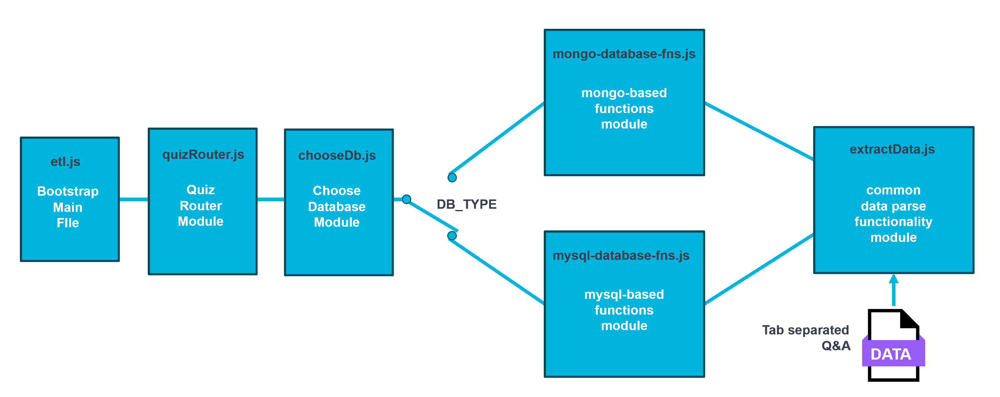

# Dual database demo
This demo illustrates the benefit of code modularisation in that the same application can use either a MySQL database or a mongo database without changing the application code.

Based on an environment variable, DB_TYPE=MY_SQL or DB_TYPE=MONGO will determine which database is used. This is enabled by keeping all the database code in separate modules and exporting functions where the functions are the same name and signature in each module so the app just calls functions and doesn't care which database it's connected to.

The demo illustrates an extract transform and load operation (ETL). It **E**xtracts data from a text file containing general knowledge questions and answers, **T**ransforms it into a form that is suitable for the appropriate database then **L**oads it into a database table.

Read the following with reference to the module architecture here



## The main program
etl.js is the bootstrap file that kicks off the application by mounting the API routes and starting the http server.

## MySql module
mysql-database-fns.js implements and exports functions called by the quiz router. It self starts hen loaded by calling createConPool() itself. This illustrates using .then() as opposed to await to show how a function can be called without it needing to be declared async.

It's generally easier to create the database outside of the app but this demo shows you how to create a new database from within the app. Because there may not be an existing database, the app connects to the MySql server without specifying a database. Once connected it can create one.

createConPool() checks if the database exists and if not, it creates it then creates a connection pool associated with it. 

It exports all the functions listed in the Common functionality section.

## MongoDb module
mongo-database-fns.js implements all the functions in the Common functionality section. 

This module self starts by calling isConnected(). If a database doesn't exist it will create one then return the name of the connected database as assurance that it is established.

The functions in the module are listed in the Common functionality section.

## quizRouter module
This router implements the following routes:

**GET /** <span style="margin-left: 10rem;">This simply states that the server is alive</span>  
**GET /etl/:table/:filename** <span style="margin-left: 1rem;">ETL **filename** into **table**</span>  
**GET /data/:table** <span style="margin-left: 5rem;">Return all the data in **table**</span>  

The source data files should be in the landing zone which is the /.data directory

This module includes the chooseDb module which will provide the router a reference to the selected database module so it can access its functionality.

## chooseDb module
This module reads the single environment variable DB_TYPE then loads the appropriate database module and exports a reference to the module for use by others, in this case, quizRouter.

## extractData module
This module is responsible for the extract part of the process and is available to both database modules. It loads the required file and parses it into two arrays: one for questions and one answers. These are read by the database module which carries out the appropriate transform operation to ready the data for loading, then loads the data into the table.

## Common functionality
These functions are exported from the MySql and Mongo modules so are available to be called from the router
```
Exported functions:

getAllData  // This retrieves all the questions and answers from the database
countRows   // Counts the number of records to show inserts are successful
createTable // Provide a name and it will create a new table with that name
etl         // Load a text file, parse it and load it into the named table
dropTable   // Delete the Named table
  ```

## Environment variables
This demo uses a variety of environment variable approaches for illustration. 

You can load environment variables from a file such as app.env using dotenv.
An env file should contain only required and sensitive values such as authentication credentials.
Non‑sensitive configuration values (like ports, log levels, feature flags) should be given defaults in code, not placed in the env file.

You could put defaults into the env file, but that duplicates configuration and creates confusion about which source of truth matters.

You could also choose to put all env vars into the env file and avoid defaults entirely. That’s valid, but if the env file isn’t available (because .env isn’t committed to Git), the user would have to guess every required value to get the app running — which is brittle and unfriendly.

If .env isn't pushed, because it contains sensitive settings then none of the other settings get pushed so if .env is lost, lots of settings are lost.

An alternative is to create two files. .env containing the sensitive stuff that isn't pushed and .env.config for needed config settings which is pushed.  Defaults can be used for values that enable the app to start, e.g. port number but are overridable if necessary.

The dev env files are not in the root as docker compose will use env files too so don't want a conflict of filenames in the same directory.

# Using containers
You could put the application and the databases in the same compose.yaml file but we would have both MySQL and MongoDB containers running when we only need one

To avoid that, you can split up the yaml file into the app, MySQL and MongoDB yaml files then join the files together at the command line

**docker compose -f etl.yaml -f mysql.yaml up -d --build** will build the etl and MySQL containers and create the Docker network as compose effectively merges these two files into one  
Or  
**docker compose -f etl.yaml -f mongo.yaml up -d --build** will build etl and mongo containers and create a network for them  

To bring the containers down, you need to specify the same file or files you use to build them
**docker compose -f etl.yaml -f mysql.yaml down -v**  -v means delete the volume holding the data
or  
**docker compose -f etl.yaml -f mysql.yaml down -v**  


